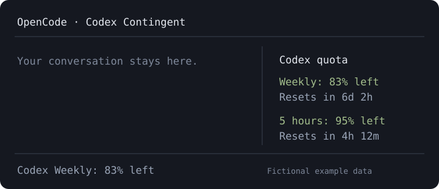

# OpenCode Codex Contingent

See your **Codex subscription quota** without leaving the OpenCode V2 terminal UI.



- Remaining quota and reset countdowns in the sidebar.
- Compact weekly quota in the prompt and home-screen footers.
- `/codex-limits` opens details and requests a refresh.
- Handles weekly-only plans and multiple quota buckets.
- Uses the documented local Codex app-server protocol, not a private ChatGPT HTTP endpoint.

**This is a community plugin, not affiliated with OpenAI or OpenCode.** It shows
the quota for the account signed into the **local Codex CLI**. That account may
differ from the one in OpenCode. It does **not** show API billing, general ChatGPT
message limits, or an app-specific OpenCode allowance from Sign in with ChatGPT.

## Requirements

- OpenCode **2.2.x**. Tested with 2.2.0; OpenCode V1 is not supported.
- The [Codex CLI](https://developers.openai.com/codex/cli), available on `PATH`
  and signed into ChatGPT. Tested with Codex 0.165.0.
- A ChatGPT account that exposes Codex quotas. API-key-only authentication does
  not provide subscription quota information.

If needed, install and sign into Codex in your own terminal:

```sh
npm install -g @openai/codex
codex login
codex login status
```

## Install from npm (after the first release)

The package scope is `@sd-softdev`. Once the first version is published:

```sh
opencode plugin add @sd-softdev/opencode-codex-contingent
```

The npm package contains compiled JavaScript; users do not need a build toolchain.
Before the initial npm publication, this command is unavailable. Installation
from GitHub below remains an alternative.

## Install from GitHub

Clone this repository into a directory of your choice:

```sh
git clone https://github.com/sd-softdev/opencode-codex-contingent.git
cd opencode-codex-contingent
npm ci --ignore-scripts
npm run build
```

Add its **absolute path** to the existing `plugins` array in
`~/.config/opencode/cli.json` (or `$XDG_CONFIG_HOME/opencode/cli.json`). Keep your
other settings and plugins:

```json
{
  "$schema": "https://opencode.ai/v2/cli.json",
  "plugins": [
    "/absolute/path/to/opencode-codex-contingent"
  ]
}
```

This source installation needs Node.js 26.4+ for the build dependencies. OpenCode
loads the compiled `./tui` entry and provides the UI runtime. Configuration
changes reload automatically; use `/reload` if needed.

To update, run `git pull --ff-only`, `npm ci --ignore-scripts`, and `npm run build`
in your clone, then `/reload` in OpenCode.
To uninstall, remove this plugin's entry from `cli.json`. This does not sign out
of Codex or remove the Codex CLI.

### Codex is not on OpenCode's PATH

Use the object form and set an executable path (not a shell command):

```json
{
  "plugins": [{
    "package": "/absolute/path/to/opencode-codex-contingent",
    "options": { "codexBinary": "/absolute/path/to/codex" }
  }]
}
```

The child process inherits `CODEX_HOME`, if set. It runs on the machine hosting
the TUI, even when OpenCode connects to a remote server.

## Refresh and troubleshooting

The plugin refreshes at startup and every **five minutes**. Manual requests via
`/codex-limits` have a **30-second minimum interval** and reuse an in-flight
request. Each request has a 15-second timeout. Reset countdowns update each minute.
After errors, the last successful values remain visible and are marked **stale**.
Each TUI instance polls independently.

- **CLI cannot start:** check `codex --version`, `PATH`, or `codexBinary`.
- **No quotas / request rejected:** run `codex login status`; if needed, use
  `codex login` with the intended ChatGPT account.
- **No sidebar:** widen the terminal or enable the sidebar; the footer and
  `/codex-limits` remain available.
- **Different numbers than OpenCode app settings:** these are separate limits.
  See [ChatGPT usage settings](https://chatgpt.com/settings/usage).

Live integration has been tested on macOS. Other operating systems have not
been live-validated; automated tests use mocked processes without authentication.

## Privacy and security

The plugin sends only `initialize`, `initialized`, and `account/rateLimits/read`
to a short-lived local `codex app-server` over stdio. It does not start model
turns, read token files or OpenCode databases, expose a network listener, or make
direct HTTP requests. Codex itself manages credentials, token renewal, and its
own network activity. Quota data stays in memory. Provider error messages and
stderr are not shown or logged by the plugin. See [SECURITY.md](SECURITY.md).

## Development

For SDK development, use Node.js 26.4+ and npm (required by OpenTUI's development
dependencies):

```sh
npm ci
npm run check
```

`npm test` also runs without installing dependencies on Node.js 22.18+. Tests
never call real accounts or models, publish packages, or create releases. UI
types come from the OpenCode 2.2.0 SDK. CI runs type checks and the build on
Node.js 26 and standalone tests on Node.js 22, 24, and 26. The preview above uses
fictional data.

## Releases

Pushing a stable `vX.Y.Z` tag starts the release workflow: validate the version,
build and test, publish to npm, download and verify the published package, then
create a GitHub release with Conventional Commit notes and the verified tarball.
The tag must match `package.json`; the workflow does not bump versions for you.

See [Release setup and procedure](docs/releasing.md) for the one-time npm OIDC
setup, first-publication prerequisite, and recovery instructions. No release is
triggered by ordinary branch pushes or pull requests.

References: [OpenCode V2 TUI plugins](https://opencode.ai/v2/docs/build/plugins/cli/)
and [Codex rate-limit RPC](https://developers.openai.com/codex/app-server#6-rate-limits-chatgpt).

## License

[MIT](LICENSE) © sd-softdev
